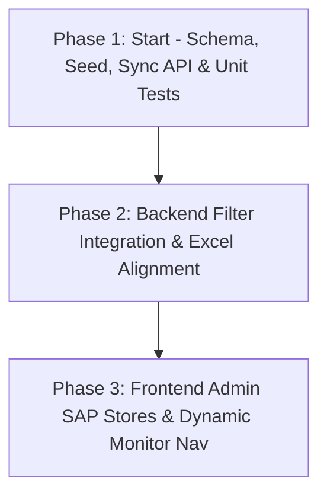

# Phân hệ Quản lý SapBrand & SapStore Active Stores

## 1. Tổng quan & Bối cảnh Kỹ thuật (Context & Objective)

Hệ thống ERP SAP HANA hiện tại của doanh nghiệp (`maycha_live.OWHS` thông qua SQL Server Linked Server `hana_mc`) đang lưu trữ toàn bộ các kho hàng thuộc nhiều thương hiệu khác nhau. Theo dữ liệu thực tế khảo sát:
- **5001 - Maycha**: 84 kho Active ('N'), 11 kho Inactive ('Y') (Tổng 95 kho)
- **5002 - Tam Hảo**: 122 kho Active ('N'), 8 kho Inactive ('Y') (Tổng 130 kho)
- **5003 - HO - DCCK**: 16 kho
- **5004 - Cloud Kitchen**: 33 kho
- **5005 - Gà Giòn Sốt 3 Cô Gái**: 19 kho
- **5006 - Trà Hú**: 2 kho
- **5007 - Thức Coffee**: 7 kho

### Vấn đề Kỹ thuật Cốt lõi (Critical Technical Challenge)
Hai màn hình điều hành tác nghiệp **Monitor Bán hàng (Go-live)** (`/sap/monitor-ban`) và **Monitor Luồng Trả** (`/sap/monitor-tra`) cần tính toán số liệu Phễu chuyển đổi (Conversion Funnel), Trạng thái chứng từ (Doc Status) và Báo cáo Excel chỉ trên các cửa hàng **được phê duyệt tham gia kinh doanh hoặc vận hành luồng trả (Active Stores)** thay vì toàn bộ kho trong SAP.

Nếu đưa danh sách mã kho lọc vào câu lệnh truy vấn SAP thông qua mệnh đề `IN ('MC001', 'MC002', ...)` trong hàm `OPENQUERY`, hệ thống sẽ lập tức đối mặt với **lỗi tràn trần 8000 ký tự của SQL Server Linked Server** (`The string literal is too long`). Khi số lượng kho của các thương hiệu như Tam Hảo (130 kho) hay Maycha (95 kho) tăng lên cùng các câu truy vấn phức tạp nối chuỗi `OPENQUERY(...)`, chiều dài chuỗi vượt quá 8000 ký tự sẽ gây crash toàn bộ hệ thống SAP Monitor.

### Giải pháp Kiến trúc: Tách biệt Truy vấn & Lọc Dữ liệu (Decoupled Filter Architecture)
1. **Truy vấn SAP HANA giữ nguyên tối giản**: Câu lệnh SQL gửi qua `OPENQUERY` vẫn chỉ lọc theo thương hiệu `W."U_Brand" = '{brand}'` (không nhồi nhét danh sách mã kho vào SQL SAP).
2. **Postgres đóng vai trò Single Source of Truth cho Cấu hình Vận hành**:
   - Lưu trữ danh mục `SapBrand` và `SapStore`.
   - Cung cấp tính năng đồng bộ tự động danh sách kho từ `maycha_live.OWHS` vào PostgreSQL.
   - Cho phép quản trị viên bật/tắt độc lập:
     - `isActiveSales`: Cửa hàng được tính vào Monitor Bán hàng.
     - `isActiveReturn`: Cửa hàng được tính vào Monitor Luồng trả.
3. **Lọc dữ liệu tại Tầng Node.js Service (In-Memory Set Filtering)**:
   - `SapSalesMonitorService` và `SapReturnMonitorService` nạp tập hợp mã kho active (`Set<string>`) từ PostgreSQL.
   - Thực hiện lọc mảng dữ liệu (`chainRows`, `listResults`, `arRows`, `grpoRows`) bằng `Set.has(row['Store'])` với độ phức tạp $O(1)$ trước khi chuyển vào các hàm tính toán Phễu, KPI và xuất Excel.
4. **Cơ chế Fallback An Toàn (Safe Fallback Guard)**:
   - Nếu một thương hiệu chưa được cấu hình bất kỳ kho active nào (`Set.size === 0`), hệ thống giữ nguyên toàn bộ dữ liệu (không lọc) và ghi log cảnh báo, đảm bảo không gây trắng màn hình hoặc lỗi đột ngột.

---

## 2. Thiết kế Dữ liệu & Cơ chế Lọc (Data Architecture & Safety)

### 2.1 Prisma Schema Design (`apps/api/prisma/schema.prisma`)

```prisma
model SapBrand {
  code      String     @id /// Mã thương hiệu SAP (vd: '5001', '5002', ...)
  name      String     /// Tên hiển thị (vd: 'Maycha', 'Tam Hảo')
  isActive  Boolean    @default(true) /// Trạng thái kích hoạt thương hiệu trên portal
  sortOrder Int        @default(0)    /// Thứ tự sắp xếp trên dropdown/menu
  createdAt DateTime   @default(now())
  updatedAt DateTime   @updatedAt
  stores    SapStore[]

  @@map("sap_brands")
}

model SapStore {
  code           String    @id /// Mã kho WhsCode từ SAP (vd: 'MC001', 'BB013')
  name           String    /// Tên kho WhsName từ SAP
  brandCode      String?   /// Mã thương hiệu U_Brand
  brand          SapBrand? @relation(fields: [brandCode], references: [code], onDelete: SetNull)
  sapInactive    Boolean   @default(false) /// Trạng thái ngưng hoạt động trên SAP (OWHS.Inactive == 'Y')
  isActiveSales  Boolean   @default(false) /// Được tính vào Monitor Bán hàng
  isActiveReturn Boolean   @default(false) /// Được tính vào Monitor Luồng trả
  syncedAt       DateTime  @default(now())  /// Thời điểm đồng bộ từ SAP gần nhất
  createdAt      DateTime  @default(now())
  updatedAt      DateTime  @updatedAt

  @@index([brandCode])
  @@index([isActiveSales])
  @@index([isActiveReturn])
  @@index([sapInactive])
  @@map("sap_stores")
}
```

### 2.2 Phân quyền Hệ thống (Access Control)
- Permission Catalog: Thêm `sap-store:manage` (`'sap-store:manage'`) vào nhóm `"Master Board"`.
- `Role.ADMIN`: Mặc định có toàn quyền thông qua `ROLE_PERMISSIONS[Role.ADMIN] = ['*']`.
- Các endpoints đọc danh sách thương hiệu phục vụ Monitor (`GET /sap/brands`): Yêu cầu quyền `sap-monitor:read` hoặc `sap-store:manage`.

### 2.3 Cơ chế Bảo toàn Cấu hình khi Đồng bộ SAP (Idempotent Sync Mechanism)
Khi quản trị viên nhấn "Đồng bộ từ SAP":
1. Backend chạy truy vấn đọc danh sách kho từ `maycha_live.OWHS`:
   ```sql
   SELECT "WhsCode", "WhsName", "U_Brand", "Inactive"
   FROM maycha_live.OWHS
   WHERE "U_Brand" IS NOT NULL
   ```
2. Thực hiện Upsert vào bảng `sap_stores`:
   - Nếu kho đã tồn tại: Cập nhật `name = WhsName`, `brandCode = U_Brand`, `sapInactive = (Inactive === 'Y')`, `syncedAt = now()`. **TUYỆT ĐỐI BẢO LƯU** `isActiveSales` và `isActiveReturn` hiện tại do admin đã cấu hình.
   - Nếu kho mới: Chèn dòng mới với `isActiveSales = false`, `isActiveReturn = false`.

---

## 3. Lộ trình Phân rã 3 Phase (Phase Breakdown)



| Phase | Tên Giai đoạn | Mục tiêu Trọng tâm | Effort | Dependencies | File Chi tiết |
|---|---|---|---|---|---|
| **Phase 1** | **Start** | Schema Prisma `sap_brands` & `sap_stores`, Seed 7 brands & 26 pilot stores, `SapStoreService`, `SapBrandService`, Controller & Unit tests | 2.0h | Không có | [`phase-01-start.md`](./phase-01-start.md) |
| **Phase 2** | **Backend Filter Integration** | Tích hợp lọc `activeSalesStoreCodes` & `activeReturnStoreCodes` vào 2 Monitor Services, đồng bộ Excel Services, Unit tests, chạy Codegen Orval | 1.5h | Phase 1 | [`phase-02-backend-filter-integration.md`](./phase-02-backend-filter-integration.md) |
| **Phase 3** | **Frontend Admin & Nav** | Menu Admin Quản trị Cửa hàng SAP, UI Trang `/admin/sap-stores` (metrics, filter, table, sync, toggle), chuyển dropdown Brand trên 2 Monitor sang động | 2.0h | Phase 2 | [`phase-03-frontend-admin-stores-and-nav.md`](./phase-03-frontend-admin-stores-and-nav.md) |

**Tổng thời gian dự kiến**: **5.5 giờ**

---

## 4. Tiêu chí Thành công Tổng thể (Global Success Criteria)

- [ ] **Bảo đảm giới hạn chuỗi SQL**: Không có bất kỳ mệnh đề `IN ('MC...', 'MC...')` nào được nối động vào chuỗi truy vấn `OPENQUERY`, loại bỏ 100% rủi ro lỗi tràn trần 8000 ký tự trên SQL Server.
- [ ] **Tính toàn vẹn dữ liệu Master Data**: Toàn bộ 7 thương hiệu chuẩn (`5001` đến `5007`) và 26 kho pilot ban đầu (`RETURN_PILOT_STORES`) được seed đầy đủ vào PostgreSQL.
- [ ] **Khả năng Đồng bộ An toàn (Safe Sync)**: Thao tác đồng bộ từ SAP HANA cập nhật chính xác tên kho và trạng thái `sapInactive` mà không làm mất cấu hình `isActiveSales` / `isActiveReturn` của người dùng.
- [ ] **Lọc Dữ liệu Nhất quán (Consistent Filtering)**: Số liệu hiển thị trên bảng Phễu chuyển đổi, Bảng trạng thái chứng từ và các file xuất Excel (11 sheets cho Bán hàng, 3 sheets cho Luồng trả) phản ánh chính xác 100% danh sách kho active đã cấu hình.
- [ ] **Cơ chế Fallback Tin cậy**: Khi một thương hiệu chưa có kho active nào, hệ thống hiển thị toàn bộ kho kèm log cảnh báo, không làm gián đoạn trải nghiệm người dùng.
- [ ] **Tuân thủ Kiến trúc CLAUDE.md**:
  - Tầng API client frontend được tự động sinh bằng Orval, không viết tay DTO/Service.
  - Tách bạch component UI và hook quản lý side-effects (`use-sap-store-actions.ts`).
  - Mọi logic tính toán thuần túy (pure logic) được tổ chức trong thư mục `lib/` kèm unit test `.spec.ts`.

---

## 5. Ma trận Rủi ro & Biện pháp Giảm thiểu (Risk & Mitigation Matrix)

| STT | Rủi ro (Risk Event) | Xác suất (L) | Mức độ (I) | Điểm | Biện pháp Giảm thiểu (Mitigation Strategy) |
|:---:|---|:---:|:---:|:---:|---|
| 1 | **Tràn trần 8000 ký tự OPENQUERY** do dev vô tình nối danh sách kho vào SQL SAP | Thấp | Rất Cao | **Cao** | Thiết kế cứng từ kiến trúc: Cấm tuyệt đối việc truyền `activeStoreCodes` vào các file query SQL. Toàn bộ logic lọc được thực hiện tại tầng Node.js Service sau khi dữ liệu SAP đã được nạp về RAM. |
| 2 | **Mất trạng thái Active sau khi Đồng bộ SAP** do câu lệnh Upsert ghi đè toàn bộ trường | Trung bình | Cao | **Cao** | Sử dụng câu lệnh Prisma `upsert` hoặc truy vấn cập nhật có chọn lọc: chỉ cập nhật `name`, `brandCode`, `sapInactive`, `syncedAt`; giữ nguyên `isActiveSales` và `isActiveReturn`. Viết unit test tự động xác nhận tính chất này. |
| 3 | **Màn hình Monitor bị trắng (0 dòng)** khi vừa cấu hình Brand mới chưa chọn kho nào | Trung bình | Cao | **Cao** | Cài đặt Safe Fallback Guard: Kiểm tra `activeStoreCodes.size === 0` thì bỏ qua bước lọc, giữ nguyên toàn bộ dữ liệu và ghi log cảnh báo. |
| 4 | **Sai lệch số liệu giữa Màn hình và File Excel xuất ra** | Thấp | Cao | **Trung bình** | `SapSalesMonitorExcelService` và `SapReturnMonitorExcelService` nhận trực tiếp đối tượng dữ liệu đã lọc từ `getSalesMonitor()` / `getReturnMonitor()`. Dữ liệu Excel thừa hưởng trực tiếp kết quả lọc mà không cần xử lý thêm. |
| 5 | **Nghẽn hiệu năng khi lọc mảng lớn trên Node.js** | Thấp | Thấp | **Thấp** | Chuyển đổi danh sách active stores thành cấu trúc `Set<string>`. Thao tác kiểm tra `activeStoreCodes.has(...)` đạt tốc độ $O(1)$, thời gian lọc hàng nghìn dòng chỉ dưới 2ms. |
| 6 | **Race condition khi nhiều Admin cùng bấm Sync từ SAP** | Thấp | Trung bình | **Thấp** | Áp dụng cơ chế khóa tạm thời (in-memory lock hoặc mutex đơn giản) trong `SapStoreService.syncFromSap()` để từ chối các request sync trùng lặp trong khi một tiến trình sync đang chạy. |

---

## 6. Đánh giá Tấn công & Kiểm thử Nghịch đảo (Red-Team Review & Attack Vectors)

Trong quá trình rà soát kiến trúc, các kịch bản kiểm thử nghịch đảo sau đây đã được phân tích và chốt phương án xử lý:

1. **Attack Vector 1: SAP HANA trả về BrandCode lạ hoặc `NULL`**:
   - *Nguy cơ*: Một số kho trong `maycha_live.OWHS` có thể có `U_Brand = NULL` hoặc chứa mã brand chưa có trong bảng `sap_brands`. Khi lưu vào PostgreSQL, nếu có foreign key constraint nghiêm ngặt sẽ gây crash tiến trình sync.
   - *Phương án xử lý*:
     - Query sync chỉ lấy các dòng `WHERE "U_Brand" IS NOT NULL`.
     - Quan hệ `SapStore.brand` được thiết lập với `@relation(..., onDelete: SetNull)`, trường `brandCode` cho phép nullable.
     - Khi sync, các mã brand chưa tồn tại trong `sap_brands` sẽ được tự động tạo mới (upsert) hoặc lưu `brandCode` an toàn.

2. **Attack Vector 2: User không có quyền nhưng gọi API toggle kho**:
   - *Nguy cơ*: Người dùng thông thường có thể đoán endpoint `PATCH /sap/stores/:code` để bật/tắt kho trái phép.
   - *Phương án xử lý*: Endpoint được bảo vệ nghiêm ngặt bằng decorator `@RequirePermissions(PERMISSIONS.SAP_STORE_MANAGE)`. Global guard `PermissionsGuard` sẽ từ chối với lỗi `403 Forbidden` ngay từ tầng Gateway trước khi chạm vào Service.

3. **Attack Vector 3: Mạng chập chờn khi chuyển trang Monitor khiến dropdown Brand hiển thị rỗng**:
   - *Nguy cơ*: Màn hình Monitor gọi `useSapBrandsGet()`, nếu mạng lag hoặc API lỗi, dropdown Brand có thể bị rỗng làm người dùng không chọn được thương hiệu.
   - *Phương án xử lý*: Frontend hook sử dụng danh sách hằng số tĩnh (`SALES_BRAND_OPTIONS` / `RETURN_BRAND_OPTIONS`) làm giá trị fallback mặc định khi query đang tải hoặc gặp lỗi.

---

## 7. Nhật ký Đánh giá Kỹ thuật (Validation Log)

- **2026-10-22 07:07**: Khảo sát thực tế cơ sở dữ liệu SAP HANA qua linked server `hana_mc`. Xác nhận có 7 nhóm thương hiệu chính (`5001` đến `5007`) với hơn 300 kho hàng.
- **2026-10-22 07:15**: Phân tích rủi ro trần 8000 ký tự của SQL Server Linked Server. Quyết định bác bỏ phương án nhúng mã kho vào SQL SAP; chính thức phê duyệt giải pháp lọc dữ liệu tại tầng Node.js Service thông qua `Set<string>`.
- **2026-10-22 07:25**: Rà soát cấu trúc mã nguồn hiện tại (`SapSalesMonitorService`, `SapReturnMonitorService`, `SapSalesMonitorExcelService`, `sidebar-nav-data.ts`). Khẳng định kiến trúc mở rộng hoàn toàn khả thi và tương thích 100% với các quy chuẩn trong `CLAUDE.md`.
- **2026-10-22 07:35**: Hoàn tất kế hoạch phân rã 3 Phase chi tiết kèm failure protocol và task checklist.
