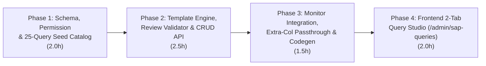

# Phân hệ Quản trị & Chỉnh sửa 25 Câu Truy vấn SAP trong DB

## 1. Tổng quan & Bối cảnh Kỹ thuật (Context & Objective)

Hiện tại toàn bộ câu truy vấn SAP HANA của 2 màn hình **Monitor Bán hàng** (`/sap/monitor-ban`) và **Monitor Luồng Trả** (`/sap/monitor-tra`) đang được viết cứng trong `apps/api/src/modules/sap/queries/sales-monitor-queries.ts` (13 câu) và `apps/api/src/modules/sap/queries/return-monitor-queries.ts` (8 câu, trong đó câu `old_pos` gộp 5 nhánh `UNION` dài 4.834 ký tự). Mỗi khi đội IT/vận hành cần điều chỉnh điều kiện lọc `WHERE` hoặc lấy thêm cột hiển thị (như các trường UDF `U_...`), dev đều phải sửa mã nguồn và deploy lại.

Theo đặc tả kỹ thuật `D:\download\Dac_Ta_Ky_Thuat_Web_Monitor_Ban_Tra.md` (Mục 12.4–12.7 & Phụ lục C) kết hợp với thiết kế UX đã chốt cùng người dùng, phân hệ này giải quyết triệt để nhu cầu trên theo 5 nguyên tắc cốt lõi:

1. **Quản trị đủ 25 câu truy vấn chia làm 2 Tab rõ ràng trên `/admin/sap-queries`:**
   - **Tab 1 — Monitor Luồng Bán (13 câu):**
     - *Nhóm 1A – Danh sách & Cảnh báo Treo (8 câu):* `funnel`, `t1`, `t2`, `t3`, `t4`, `ar`, `grpo`, `ap`.
     - *Nhóm 1B – Ghép Chuỗi PO & Phễu 5 bước (5 câu):* `chain_po`, `chain_so`, `chain_ar`, `chain_grpo`, `chain_ap`.
   - **Tab 2 — Monitor Luồng Trả (12 câu):**
     - *Nhóm 2A – Ghép Chuỗi Trả hàng & Từ điển Kho (7 câu):* `ret_po`, `ret_so`, `ret_do`, `ret_ar`, `ret_grpo`, `ret_ap`, `ret_whs`.
     - *Nhóm 2B – Tìm Chứng từ Nhóm Cũ (5 câu đơn lẻ tách từ 5 nhánh `UNION` của `old_pos`):* `ret_old_1`, `ret_old_2`, `ret_old_3`, `ret_old_4`, `ret_old_5` (giảm độ dài mỗi câu từ 4.834 ký tự xuống ~950 ký tự, cố định điều kiện `P."DocDate" < '{d}'` ngay trong SQL gốc, triệt tiêu nguy cơ tràn 8.000 ký tự `OPENQUERY` và giúp IT dễ đọc/sửa từng nhánh). <!-- Updated: Red Team 2026-10-29 - cố định P."DocDate" < '{d}' cho ret_old_1..5 -->
2. **Định dạng Full SQL trải phẳng để IT Copy/Paste 1 mạch:**
   - Không dùng bảng `query_fragments` rời rạc. Mọi đoạn tĩnh (`{po_cols}`, `{po_grp}`, `{base}`, `{grpo_join}`...) đều được bung phẳng sẵn thành câu SQL hoàn chỉnh trong bản Seed `v1`.
   - Chỉ giữ đúng các biến runtime bắt buộc mà engine điều khiển lúc chạy: `{d}`, `{br}`, `{po_filter}`, `{brand}`, `{date_cond}` (riêng `ret_old_1..5` chỉ dùng `{d}` và `{brand}`).
3. **Nút `Review & Validate` đối chiếu trực tiếp với Câu gốc (`v1`):**
   - **Kiểm tra tĩnh (Static Check):** Quét biến runtime trên văn bản gốc trước, sau đó dùng lexer tách chuỗi `'...'` và định danh `"..."` để kiểm tra chỉ cho phép 1 câu `SELECT`/`WITH`, chặn `;`, comment `--`/`/* */`, và các từ khóa ghi/DDL/thủ tục (`INSERT, UPDATE, DELETE, MERGE, UPSERT, DROP, ALTER, CREATE, TRUNCATE, GRANT, REVOKE, CALL, EXEC, EXECUTE, INTO`); kiểm tra mọi bảng sau `FROM`/`JOIN` phải có prefix `maycha_live.` hoặc `kbmd_live.`; kiểm tra độ dài sau escape trong `OPENQUERY` $\le 7.800$ ký tự (tính cả kịch bản lô 300 PO). <!-- Updated: Red Team 2026-10-29 - lexer tách chuỗi/định danh và kiểm tra bảng sau FROM/JOIN -->
   - **Chạy thử thật & Đối chiếu Hợp đồng Cột:** Thực thi câu SQL mới qua `SapQueryGatewayService` (có cờ `isReviewRunning` chống xếp hàng chồng trên `FifoLock` và timeout riêng 15s), kiểm tra danh sách cột trả về (`columns`) có chứa đủ 100% **Cột bắt buộc (`requiredColumns`)** của câu gốc hay không; phát hiện **Cột mới thêm (`extraColumns` so với `baselineColumns`)**; kiểm tra tính duy nhất của `dedupKeys` và tiền tố `'Da den'` / `'Chua den'` của cột `Ghi chu ShipDate` trên `t2`/`t3`; trả về tối đa 50 dòng xem trước + thời gian chạy + `sqlHash` đã xác thực. <!-- Updated: Red Team 2026-10-29 - bảo vệ FifoLock, baselineColumns và dedupKeys -->
4. **Hỗ trợ hiển thị Cột phụ mới thêm (Extra Columns Passthrough):**
   - Với 7 danh sách lẻ của Luồng Bán (`t1..t4, ar, grpo, ap`), lưới `SapDataGrid` và `SapSalesMonitorExcelService` đã đọc động `table.columns`.
   - Nâng cấp `assemblePoChain` (`sales-po-chain.ts`) + `SapSalesMonitorService` (`sap-sales-monitor.service.ts:253-261`), và `assembleReturnChain` + `buildReturnArNoInv` (`return-chain.ts`) + `SapReturnMonitorService` (`sap-return-monitor.service.ts:263,289`) để tự động nối tiếp (passthrough) các cột phụ mới thêm (ngoài `baselineColumns`) từ câu `chain_po`, `ret_po`, `ret_ar` vào cuối bảng `Chi tiết theo PO` / `A/R chưa xuất HĐ` và file Excel. <!-- Updated: Red Team 2026-10-29 - cập nhật cả sap-sales-monitor.service.ts:261 và baselineColumns -->
5. **Quản lý Phiên bản Append-Only, Snapshot Bất biến & Hoàn tác 1 click:**
   - Đầu mỗi lần tải Monitor (`executeFetch`), lấy 1 `snapshot` bất biến `{ epoch, sqlByKey }` từ `SapQueryConfigService` để dùng xuyên suốt cả Nhóm Mới lẫn mọi lô 300 PO Nhóm Cũ, ngăn chặn tuyệt đối lỗi trộn 2 cấu trúc cột khi IT publish giữa chừng. <!-- Updated: Red Team 2026-10-29 - frozen snapshot chống lệch cột mid-fetch -->
   - Mọi thao tác Xuất bản (`publish`), Hoàn tác (`rollback`), và Khôi phục mặc định (`reset-default`) đều tạo phiên bản mới theo cơ chế append-only (`versionNo = MAX(versionNo) + 1`), ghi `SapQueryAudit` (kể cả khi `review`), và chỉ cập nhật bộ nhớ đệm + tăng `configEpoch` sau khi transaction DB commit thành công.

---

## 2. Caller-First Type Sketch & Kiến trúc Dữ liệu (`pstack` Architect)

### 2.1 Caller Usage (Trải nghiệm của Service gọi vào Engine với Frozen Snapshot)

```typescript
// 1. Trong SapSalesMonitorService.executeFetch(dateFrom, brand):
const querySnapshot = await this.queryConfigService.getSnapshot();
const listSqlMap = this.queryConfigService.buildSalesListSqlMap(querySnapshot, dateFrom, brand);
for (const key of SALES_LIST_ORDER) {
  rawListResults[key] = await this.gateway.run(`sales-list:${key}`, listSqlMap[key]);
}

const chainSqlMap = this.queryConfigService.buildSalesChainSqlMap(querySnapshot, dateFrom, brand);
// Và cho từng lô 300 PO cũ (dùng cùng querySnapshot bất biến + kiểm tra khớp columns):
const chunkSqlMap = this.queryConfigService.buildSalesChainSqlMap(querySnapshot, dateFrom, brand, chunk);

// 2. Trong SapReturnMonitorService.executeFetch(dateFrom, brand):
const querySnapshot = await this.queryConfigService.getSnapshot();
const returnSqlMap = this.queryConfigService.buildReturnMainSqlMap(querySnapshot, dateFrom, brand);
const oldDiscoverySqlMap = this.queryConfigService.buildReturnOldDiscoverySqlMap(querySnapshot, dateFrom, brand);
const batchSqlMap = this.queryConfigService.buildReturnMainSqlMap(querySnapshot, dateFrom, brand, chunk);
```

### 2.2 Prisma Schema (`apps/api/prisma/schema.prisma`)

```prisma
model SapQueryDef {
  key                  String            @id /// Khóa định danh chuẩn (1 trong 25 khóa: funnel, t1..ap, chain_po..chain_ap, ret_po..ret_whs, ret_old_1..ret_old_5)
  flow                 String            /// 'ban' | 'tra'
  stage                String            /// 'list' | 'chain' | 'main' | 'old_discovery'
  sortOrder            Int               /// Thứ tự 1..25 theo đúng tài liệu
  title                String            /// Nhãn tiếng Việt dễ hiểu cho IT
  description          String            /// Mô tả vai trò nghiệp vụ và nguồn bảng
  impactBadges         String[]          @default([]) /// Danh sách vùng UI/KPI bị ảnh hưởng
  allowedPlaceholders  String[]          @default([]) /// Danh sách biến runtime bắt buộc giữ (vd: ['{d}', '{br}'])
  requiredColumns      String[]          @default([]) /// Hợp đồng cột bắt buộc (Core Columns)
  baselineColumns      String[]          @default([]) /// Toàn bộ cột trả về của câu gốc v1 (kể cả cột ẩn như PO DocEntry, Kho PO min/max)
  dedupKeys            String[]          @default([]) /// Khóa khử trùng theo đặc tả 12.5
  supportsExtraColumns Boolean           @default(true)
  defaultSql           String            /// Câu Full SQL gốc (Seed v1) dùng để đối chiếu & khôi phục
  currentVersionNo     Int               @default(1)
  lastTestedSqlHash    String?           /// SHA-256 của câu SQL đã chuẩn hóa vượt qua Review & Validate gần nhất
  lastTestedAt         DateTime?
  lastTestedById       String?
  lastTestRowCount     Int?
  lastTestDurationMs   Int?
  createdAt            DateTime          @default(now())
  updatedAt            DateTime          @updatedAt
  versions             SapQueryVersion[]
  audits               SapQueryAudit[]

  @@index([flow, sortOrder])
  @@map("sap_query_defs")
}

model SapQueryVersion {
  id          String      @id @default(cuid())
  queryKey    String
  query       SapQueryDef @relation(fields: [queryKey], references: [key], onDelete: Cascade)
  versionNo   Int
  sqlText     String
  sqlHash     String
  changeNote  String
  createdById String?
  createdBy   String?
  createdAt   DateTime    @default(now())

  @@unique([queryKey, versionNo])
  @@index([queryKey, versionNo])
  @@map("sap_query_versions")
}

model SapQueryAudit {
  id          String      @id @default(cuid())
  queryKey    String
  query       SapQueryDef @relation(fields: [queryKey], references: [key], onDelete: Cascade)
  action      String      /// 'review' | 'publish' | 'rollback' | 'reset_default'
  fromVersion Int?
  toVersion   Int?
  beforeSql   String?
  afterSql    String?
  changeNote  String?
  actorId     String?
  actorName   String?
  createdAt   DateTime    @default(now())

  @@index([queryKey, createdAt])
  @@map("sap_query_audits")
}
```

---

## 3. Lộ trình Phân rã 4 Phase (Phase Breakdown)



| # | Phase | Mục tiêu Trọng tâm | Effort | Dependencies | Status |
|---|---|---|---|---|---|
| 1 | [Phase 1: Schema, Permission & 25-Query Seed Catalog](./phase-01-start.md) | Model Prisma `SapQueryDef`/`SapQueryVersion`/`SapQueryAudit`, quyền `sap-query:manage`, danh mục 25 câu Full SQL (`SAP_QUERY_CATALOG` có `baselineColumns` & `requiredColumns`) kèm unit test đối chiếu khớp 100% ký tự với query hiện tại | 2.0h | Không có | Completed |
| 2 | [Phase 2: Backend Engine, Review Validator & CRUD API](./phase-02-backend-engine-and-api.md) | Engine bung biến runtime từ frozen snapshot, Static Lexer Validator, Dry-run đối chiếu Hợp đồng Cột & `dedupKeys`, `SapQueryConfigService` (append-only version) & `SapQueriesController` | 2.5h | Phase 1 | Completed |
| 3 | [Phase 3: Monitor Integration, Extra-Col Passthrough & Codegen](./phase-03-monitor-integration-and-passthrough.md) | Nối `SapQueryConfigService` (frozen snapshot) vào `SapSalesMonitorService` & `SapReturnMonitorService`, nâng cấp passthrough cột mới cho `assemblePoChain` & `assembleReturnChain`/`buildReturnArNoInv`, chạy `pnpm codegen` | 1.5h | Phase 2 | Completed |
| 4 | [Phase 4: Frontend 2-Tab Admin Query Studio](./phase-04-frontend-admin-query-studio.md) | Trang `/admin/sap-queries` (2 Tab Luồng Bán 13 câu / Luồng Trả 12 câu, Split-pane Editor, nút Review & Validate cột gốc + Preview 50 dòng, Xuất bản, Lịch sử/Diff/Hoàn tác) + Shortcut trên 2 trang Monitor | 2.0h | Phase 3 | Completed |

---

## 4. Goals

| # | Goal | Priority |
|---|------|----------|
| 1 | Chuẩn hóa 25 câu truy vấn SAP vào 2 Tab (13 Bán + 12 Trả) dưới dạng Full SQL trải phẳng lưu trong DB, khớp 100% ký tự với logic hiện hành khi ở bản mặc định `v1`. | P1 |
| 2 | Cung cấp cơ chế `Review & Validate` chạy `SELECT` thật trên SAP (có bảo vệ `FifoLock`) và đối chiếu từng cột trả về với Hợp đồng Cột gốc trước khi cho phép Xuất bản. | P1 |
| 3 | Tự động hiển thị các cột phụ mới thêm (Extra Columns ngoài `baselineColumns`) trên cả lưới dữ liệu UI và file Excel của 2 màn hình Monitor Bán & Trả mà không cần build lại code. | P1 |
| 4 | Bảo đảm an toàn tuyệt đối cho SAP HANA qua Linked Server (chỉ `SELECT` trên `maycha_live`/`kbmd_live`, kiểm tra độ dài $\le 7.800$ ký tự, snapshot bất biến trong suốt lần tải, lưu phiên bản append-only, audit log và hoàn tác 1 click). | P1 |

---

## 5. Success Criteria

- [ ] **Khớp 100% câu SQL gốc (Zero Regression):** Unit test chứng minh 13 câu Bán và 12 câu Trả khi bung từ `SAP_QUERY_CATALOG` với tham số mẫu khớp 100% từng ký tự với `buildSalesListQueries`, `buildSalesChainQueries` và `buildReturnQueries` (5 nhánh của `old_pos` khớp đúng 5 câu `ret_old_1..5`), và cả 25 câu seed `v1` đều vượt qua `validateQueryStatic`.
- [ ] **Chặn tuyệt đối câu SQL vi phạm Hợp đồng Cột hoặc Bảo mật:** Gửi câu SQL thiếu cột bắt buộc (vd thiếu `"PO Number"`), thiếu biến runtime (`{po_filter}`, `{date_cond}`), truy cập bảng ngoài `maycha_live`/`kbmd_live`, chứa từ khóa cấm (`UPDATE`, `DELETE`, `EXEC`, `;`), hoặc vượt 7.800 ký tự $\rightarrow$ API `POST /sap/queries/:key/review` trả về `valid: false` kèm danh sách lỗi cụ thể và chặn `POST /sap/queries/:key/publish`.
- [ ] **Hiển thị cột mới thêm (Extra Columns Passthrough):** Khi thêm cột mới vào một câu danh sách (`t1..ap`) hoặc câu gốc chuỗi (`chain_po`, `ret_po`, `ret_ar`), cột mới tự động xuất hiện ở cuối bảng dữ liệu trên giao diện Monitor và trong file Excel xuất ra; khi dùng câu gốc `v1`, các cột nội bộ (`PO DocEntry`, `Kho PO min`, `Kho PO max`) không bị lộ ra thành cột phụ.
- [ ] **Giao diện 2 Tab dễ dùng cho IT:** Trang `/admin/sap-queries` hiển thị đúng 2 Tab (*Monitor Luồng Bán – 13 câu* và *Monitor Luồng Trả – 12 câu*), mỗi câu có tên tiếng Việt rõ nghĩa, badge vùng ảnh hưởng, nút Copy SQL gốc/mẫu, nút Review & Validate hiện bảng đối chiếu cột + dữ liệu preview, lịch sử phiên bản và nút Hoàn tác / Khôi phục mặc định.
- [ ] **Xác minh 3 tầng (Verification Triplet):** Toàn bộ test suite (`pnpm --filter=api test`, `pnpm --filter=web test`), kiểm tra kiểu (`pnpm --filter=web check-types`), và build (`pnpm build`) đều vượt qua.

---

## Red Team Review

### Session — 2026-10-29
**Findings:** 7 deduplicated findings from 3 adversarial reviewers (`SecurityAdversary`, `AssumptionDestroyer`, `FailureModeAnalyst`) — **7 accepted, 0 rejected**.
**Severity breakdown:** 3 Critical, 3 High, 1 Medium.

| # | Finding | Severity | Disposition | Applied To |
|---|---------|----------|-------------|------------|
| 1 | Race condition khi Publish giữa lúc Monitor đang tải các lô 300 PO cũ làm lệch vị trí cột (`rows.push`) | Critical | Accept | `plan.md` §1, §2.1; Phase 2; Phase 3 |
| 2 | Validate tham số runtime (`dateFrom`, `brand`) khi Review & quét biến `{d}` trước khi lexer tách chuỗi `'...'`/`"..."` | Critical | Accept | Phase 2 |
| 3 | Kiểm tra bảng đứng sau `FROM`/`JOIN` phải có prefix `maycha_live.` hoặc `kbmd_live.` thay vì regex `<ident>.<ident>` đơn giản | Critical | Accept | Phase 2 |
| 4 | Passthrough cột mới bị chặn ở `sap-sales-monitor.service.ts:261`, `buildReturnArNoInv` và cần `baselineColumns` để ẩn `PO DocEntry`/`Kho PO min/max` | High | Accept | `plan.md` §2.2; Phase 1; Phase 2; Phase 3 |
| 5 | 5 câu `ret_old_1..5` cố định điều kiện `P."DocDate" < '{d}'` trong SQL gốc thay vì dùng `{date_cond}` | High | Accept | Phase 1; Phase 2; Phase 4 |
| 6 | Bảo vệ `FifoLock` bằng cờ `isReviewRunning` (`409 Conflict` khi đang có Review chạy) + timeout riêng 15s + kiểm tra trùng `dedupKeys` | High | Accept | Phase 2 |
| 7 | Cập nhật `users.service.spec.ts:79`, `initPromise` single-flight đồng bộ `defaultSql`, và `versionNo = MAX(versionNo) + 1` append-only | Medium | Accept | `plan.md` §2.2; Phase 1; Phase 2 |

### Whole-Plan Consistency Sweep
- Files reread: `plan.md`, `phase-01-start.md`, `phase-02-backend-engine-and-api.md`, `phase-03-monitor-integration-and-passthrough.md`, `phase-04-frontend-admin-query-studio.md`
- Decision deltas checked: 7
- Reconciled stale references: 7 (updated `ret_old_1..5` placeholders across Phase 1/2/4, added `baselineColumns` across `plan.md`/Phase 1/2/3, unified `computeSqlHash` normalization across Phase 2/4, replaced per-chunk `build*SqlMap` with frozen `querySnapshot`, added `users.service.spec.ts` to Phase 1, updated `sap-sales-monitor.service.ts:261` passthrough in Phase 3)
- Unresolved contradictions: 0

## Validation Log

### Verification Results
- **Tier:** Standard (4 phases, Fact Checker + Contract Verifier + Flow Tracer)
- **Claims checked:** 40
- **Verified:** 40 | **Failed:** 0 | **Unverified:** 0

### Confirmed Decisions
1. **Phạm vi 25 câu truy vấn trên 2 Tab:** Tab 1 (Luồng Bán: 8 câu danh sách + 5 câu chuỗi PO = 13 câu) và Tab 2 (Luồng Trả: 7 câu chính + 5 câu tìm đơn cũ `ret_old_1..5` tách từ 5 nhánh `UNION` của `old_pos` = 12 câu). Việc nâng cấp logic Luồng Trả sang gốc SO của đặc tả 28/10 tách sang Task 2 kế tiếp.
2. **Định dạng Full SQL trải phẳng:** Bung sẵn các đoạn tĩnh (`{po_cols}`, `{po_grp}`, `{base}`, `{grpo_join}`...) thành câu SQL hoàn chỉnh trong Seed `v1` để IT Copy/Paste 1 mạch; chỉ giữ các biến runtime bắt buộc (`{d}`, `{br}`, `{po_filter}`, `{brand}`, `{date_cond}`).
3. **Red-Team Hardening (7/7 Accepted):** Áp dụng Frozen Snapshot chống lệch cột mid-fetch, State-Machine Lexer kiểm tra tĩnh, kiểm tra bảng sau `FROM`/`JOIN`, tách `baselineColumns` vs `requiredColumns` cho Passthrough cột mới, cố định `P."DocDate" < '{d}'` ở `ret_old_1..5`, cờ `isReviewRunning` bảo vệ `FifoLock`, và `versionNo = MAX(versionNo) + 1` append-only.

### Whole-Plan Consistency Sweep
- Files reread: `plan.md`, `phase-01-start.md`, `phase-02-backend-engine-and-api.md`, `phase-03-monitor-integration-and-passthrough.md`, `phase-04-frontend-admin-query-studio.md`
- Decision deltas checked: 10
- Reconciled stale references: 7
- Unresolved contradictions: 0

<!-- slug: sap-query-admin-25-queries -->
